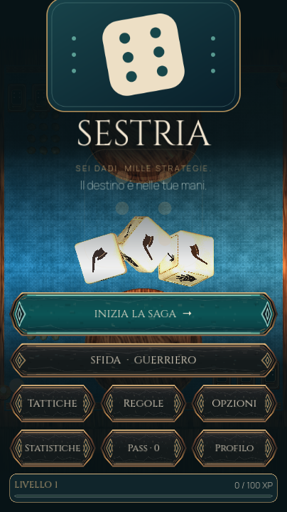
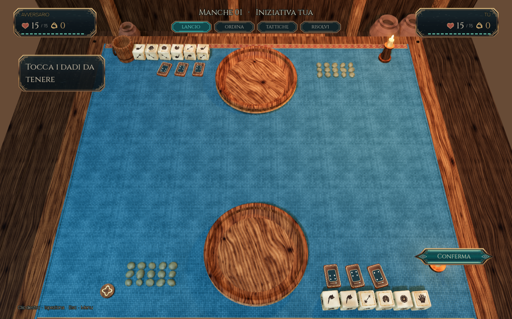

# Sestria

**Sei dadi. Mille strategie.** Un gioco di dadi 3D con materiali in legno e tessuto, tattiche combinabili e un’interfaccia Android verticale.

[Scarica l’ultima versione](https://github.com/gattomorto24/sestria/releases/latest) per Android, macOS (Intel e Apple Silicon) e Windows x64 · [Istruzioni mobile](mobile/README.md) · [Pubblicare aggiornamenti](docs/releases.md)

 

## Gioca

- Tocca i dadi 3D per selezionarli. Tieni premuto per ispezionarli e ruotarli.
- Porta tre tattiche al tavolo e scegli quando spendere i gettoni.
- Vinci nella saga offline per ottenere XP, livelli e due punti Pass per avanzamento.
- Spendi i punti in cinque potenziamenti a gradi, con riassegnazione gratuita.
- Sfida un amico sulla stessa rete Wi-Fi o hotspot, senza server di gioco o account obbligatorio.
- Collega facoltativamente un profilo Google; i progressi restano sul dispositivo.

Su computer il tavolo resta in orizzontale: clic sinistro per selezionare, clic destro per ispezionare le sei facce, Spazio o Invio per avanzare, Esc per il menu. Statistiche, Pass e LAN sono nel menu principale; gli aggiornamenti in **Impostazioni → Info**. I pacchetti Mac e Windows non sono notarizzati né firmati con un certificato commerciale: il sistema operativo può mostrare un avviso al primo avvio. L’app verifica la SHA-256 del nuovo pacchetto e lo salva in Download, ma non sostituisce mai se stessa.

Da **Opzioni → Aggiornamenti → Verifica nuovi aggiornamenti** l’app consulta le release pubbliche di questo repository. Prima di proporre l’installazione verifica SHA-256, identificativo dell’app, versione e firma. Android chiede la conferma finale. Nessun token GitHub o segreto di firma viene distribuito con l’app.

## Progetto

`mobile/` contiene l’edizione Android: interfaccia verticale, aree sicure, caricamento personalizzato, profili grafici, progressione, LAN, accesso Google e aggiornamenti. Il progetto alla radice è l’edizione desktop per macOS e Windows, con la stessa progressione, statistiche, regole e protocollo LAN. Entrambi usano Godot 4.7.1.

I materiali, le texture, i dadi, gli effetti e l’audio sono conservati nella presentazione originale del tavolo. Il marchio Sestria, le tavole delle tattiche e i testi usano una presentazione astratta e neutra.

## Sviluppo e verifica

Apri `mobile/project.godot` con Godot 4.7.1 e importa le risorse. Dalla directory `mobile`:

```sh
godot --headless --editor --import --quit
godot --headless --script res://tests/rules_test.gd
godot --headless --script res://tests/stats_test.gd
godot --headless --script res://tests/progression_test.gd
godot --headless --script res://tests/updater_test.gd
godot --headless --script res://tests/lan_lifecycle_test.gd
godot --headless --fixed-fps 120 --script res://tests/lan_test.gd -- --lan-favors
godot --script res://tests/mobile_test.gd
```

I test separano statistiche e progressi di prova dai dati del giocatore. La LAN richiede il permesso di aprire socket locali. Gli script di collaudo Android sono esclusi dall’APK release.

La chiave di firma Android resta in una cartella privata esclusa da Git. I nomi tecnici del package e alcuni identificativi di migrazione vengono conservati per permettere aggiornamenti compatibili e recuperare i salvataggi esistenti. Il nome pubblico del gioco è Sestria.

Font Cinzel e Manrope distribuiti con le rispettive licenze OFL in `assets/fonts/` e `mobile/assets/fonts/`.
